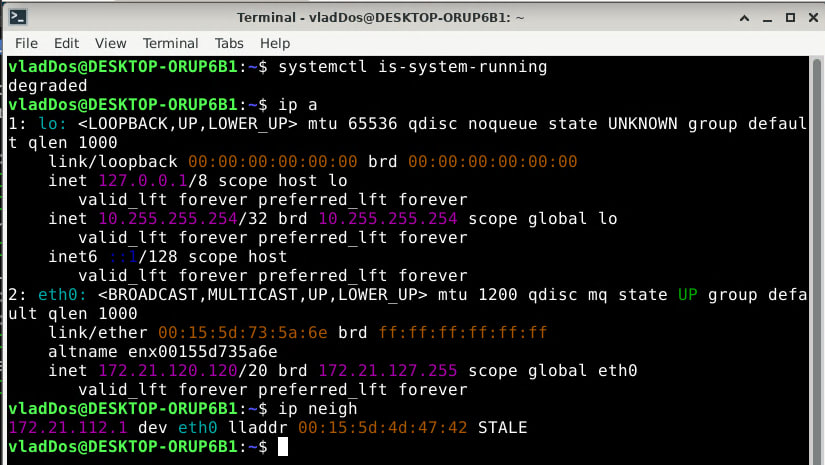
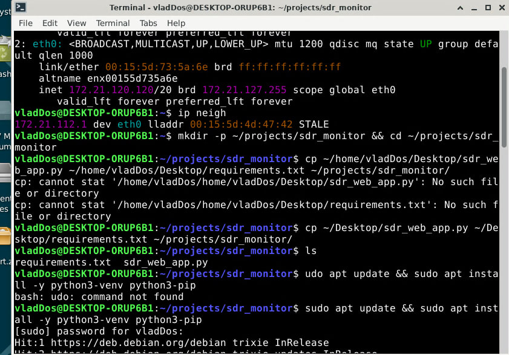
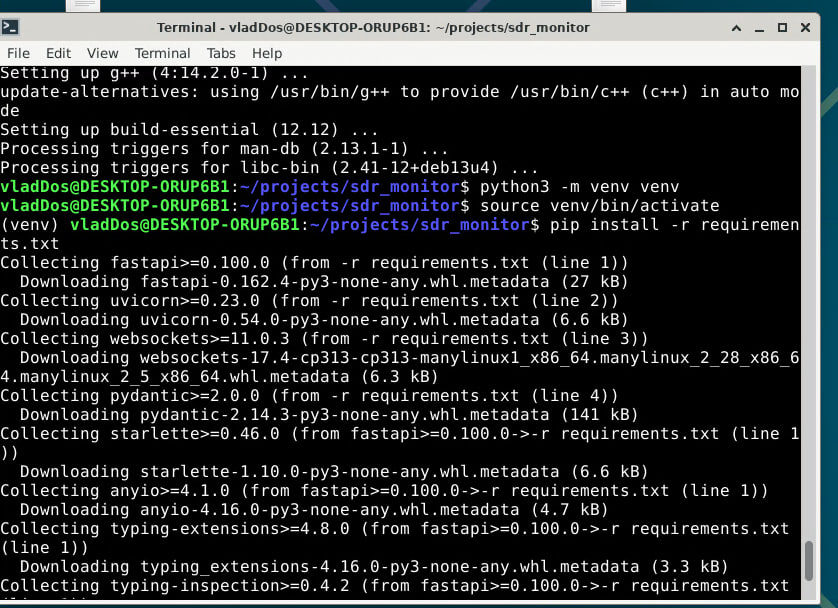
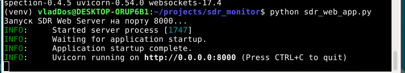
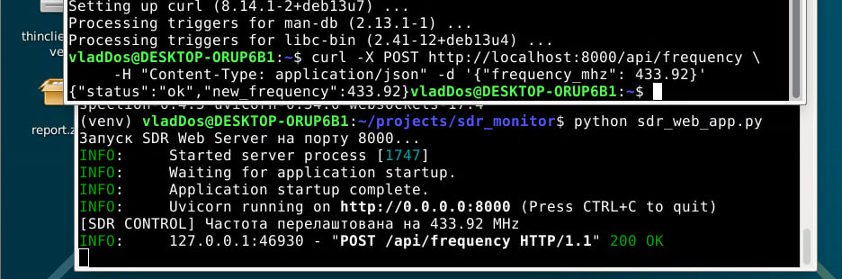
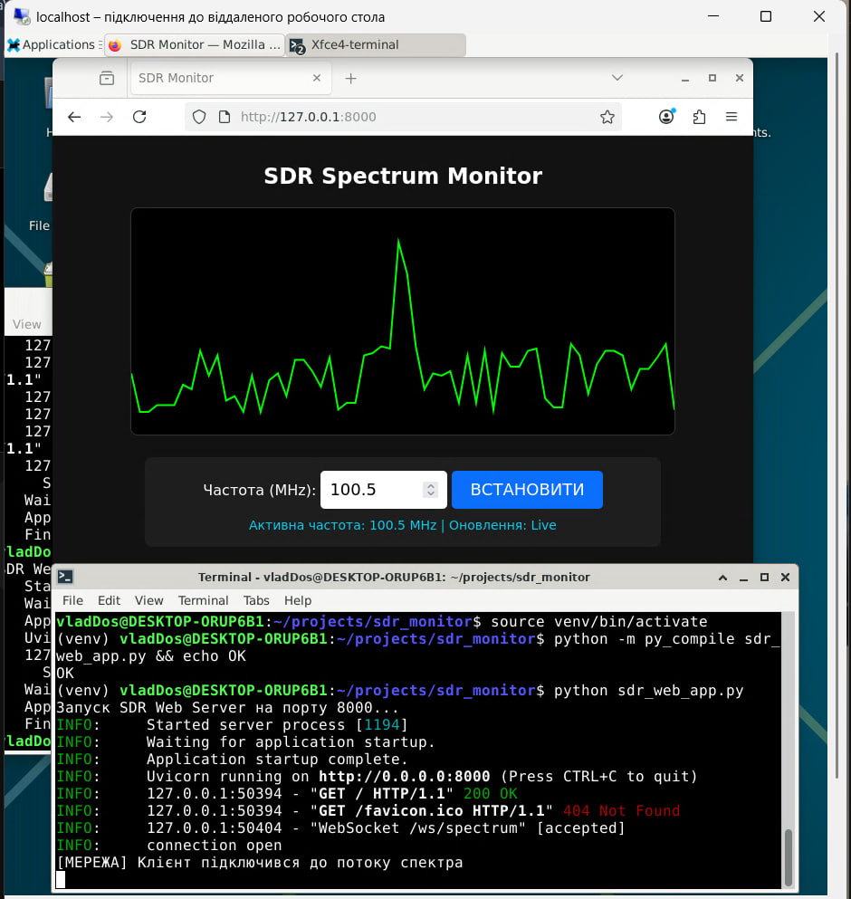
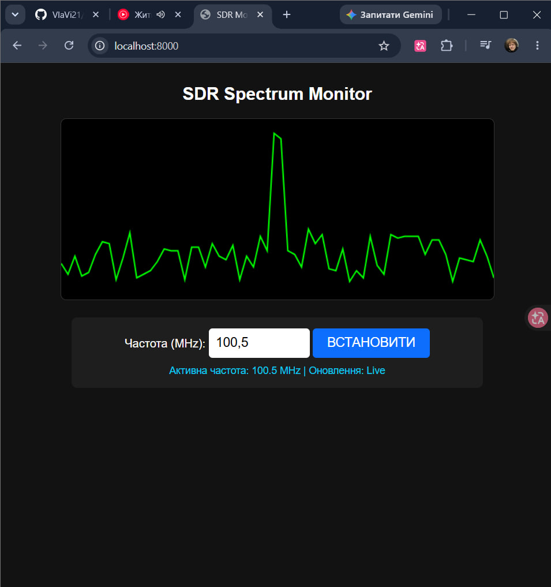
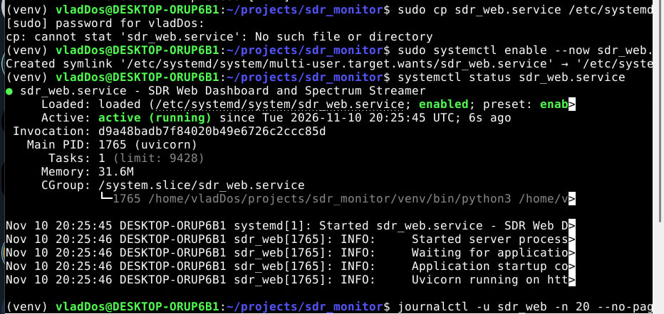
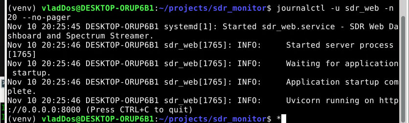
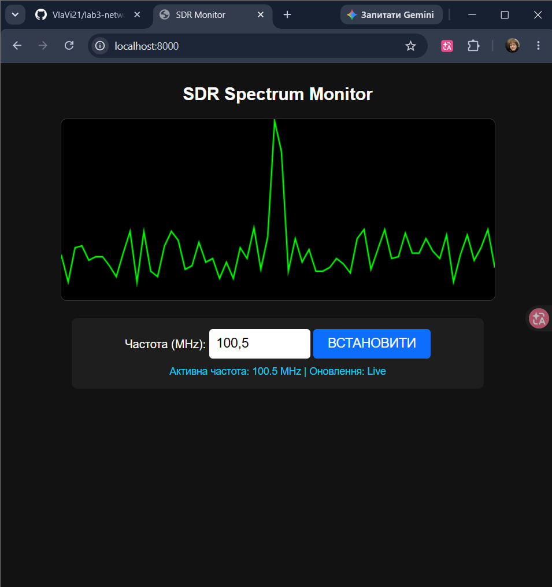

# Лабораторна робота №4: Веб-сервіс для віддаленого керування SDR-приймачем

**Студент:** Бовсунівський Владислав, РС-31

**Тема:** Розгортання веб-сервісу (FastAPI + WebSockets) для віддаленого керування SDR-приймачем та потокової візуалізації радіоспектра.
**Середовище:** Windows + WSL2, Debian 13 (trixie), Python 3, FastAPI, Uvicorn, systemd.

## Мета роботи

Опанувати розгортання асинхронного веб-сервера на базі Linux, налаштування двостороннього зв'язку через WebSockets для передачі даних спектра в реальному часі та створення мобільного веб-інтерфейсу для керування частотою SDR.

## Структура репозиторію

```
lab4-network/
├── sdr_web_app.py        # FastAPI-додаток (REST + WebSocket + HTML-інтерфейс)
├── requirements.txt      # залежності Python
├── sdr_web.service       # systemd-юніт для автозапуску
├── README.md             # цей звіт
├── video/
│   └── demo.mp4          # відеодемонстрація роботи
└── screenshots/          # скріншоти до звіту (01 ... 10)
```

## Відеодемонстрація

▶ [**video/demo.mp4**](video/demo.mp4) — запис роботи сервісу (автозапуск через systemd, підключення до WebSocket, потік спектра).

## Архітектура

```
 Браузер / смартфон                     Linux (WSL2 / Raspberry Pi)
┌──────────────────────┐   HTTP GET /          ┌─────────────────────────┐
│  HTML + JS           │◄─────────────────────►│  FastAPI + Uvicorn      │
│  <canvas> спектр     │   POST /api/frequency │   ├─ GET  /             │
│  форма частоти       │──────────────────────►│   ├─ POST /api/frequency│──► драйвер SDR
│                      │   WS /ws/spectrum     │   └─ WS   /ws/spectrum  │◄── FFT-дані
└──────────────────────┘◄──────────────────────└─────────────────────────┘
```

| Маршрут | Метод | Призначення |
|---|---|---|
| `/` | GET | віддає веб-інтерфейс |
| `/api/frequency` | POST | приймає `{"frequency_mhz": 433.92}` (24–1766 MHz) і передає драйверу SDR |
| `/ws/spectrum` | WebSocket | ~20 кадрів/с: `{"frequency": ..., "fft_data": [64 значення]}` |

## Хід роботи

### 1. Перевірка мережі
```bash
ip a
ip neigh
```


Інтерфейс `eth0` має адресу **172.21.120.120/20**. Шлюз **172.21.112.1** присутній у таблиці сусідів (`ip neigh`, стан `STALE` — запис є, але давно не використовувався).

### 2. Підготовка середовища
Створення каталогу проєкту, копіювання файлів, встановлення `python3-venv` та `python3-pip`:



Віртуальне середовище та залежності (`fastapi`, `uvicorn`, `websockets`, `pydantic`):
```bash
python3 -m venv venv
source venv/bin/activate
pip install -r requirements.txt
```


### 3. Запуск і перевірка бекенду
```bash
python sdr_web_app.py
```


Перевірка REST-ендпоінта командою `curl`:
```bash
curl -X POST http://localhost:8000/api/frequency \
     -H "Content-Type: application/json" -d '{"frequency_mhz": 433.92}'
```
Відповідь `{"status":"ok","new_frequency":433.92}`, у логу сервера — `POST /api/frequency 200 OK`:



### 4. Фронтенд (спектроаналізатор)
Сторінка адаптивна (`meta viewport`), спектр малюється на `<canvas>`, дані надходять по WebSocket, частота змінюється формою через `fetch` POST. У логу сервера видно `WebSocket /ws/spectrum [accepted]`.

Firefox у Linux-середовищі (WSL):


Chrome у Windows (`localhost:8000`):


### 5. Автозапуск через systemd
```bash
sudo cp sdr_web.service /etc/systemd/system/
sudo systemctl daemon-reload
sudo systemctl enable --now sdr_web.service
systemctl status sdr_web.service
journalctl -u sdr_web -n 20 --no-pager
```
Сервіс у стані `enabled` та `active (running)`:



Журнал сервісу:



Інтерфейс працює вже від сервісу systemd (ручний запуск не потрібен):



## Проблеми, що виникли, та їх вирішення

| Проблема | Причина | Рішення |
|---|---|---|
| `curl: command not found` | у мінімальному Debian у WSL немає curl | `sudo apt install -y curl` |
| Графік не малюється, статус «Підключення до SDR…» | при копіюванні коду з PDF розірвалися JS-коментарі (`//` + перенос рядка), у консолі браузера — `SyntaxError`, скрипт не виконувався, WebSocket не відкривався | код записано заново без розривів рядків |
| `cp: cannot stat 'sdr_web.service'` | файл юніта не було в поточному каталозі | створено `sdr_web.service` у каталозі проєкту, шлях і користувача підставлено автоматично |
| `python: command not found` | віртуальне середовище не було активоване | `source venv/bin/activate` |

## Висновки

Розгорнуто асинхронний веб-сервер на FastAPI/Uvicorn, реалізовано REST-ендпоінт керування частотою та WebSocket-потік спектра (~20 к/с). Створено адаптивний інтерфейс на canvas. Сервіс налаштовано на автозапуск через systemd з перезапуском при збої (`Restart=always`). Для роботи з реальним SDR достатньо замінити генерацію `mock_fft` читанням FFT-буфера з приймача, а `set_hardware_freq()` — викликом драйвера.
